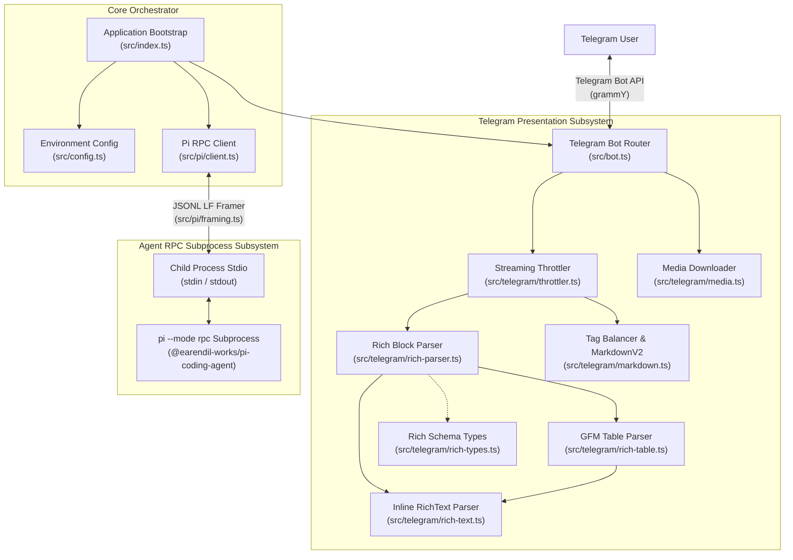
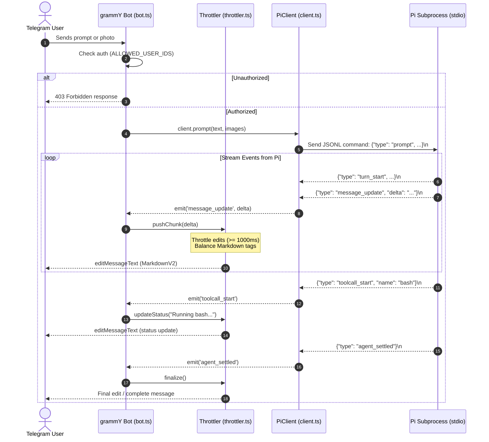
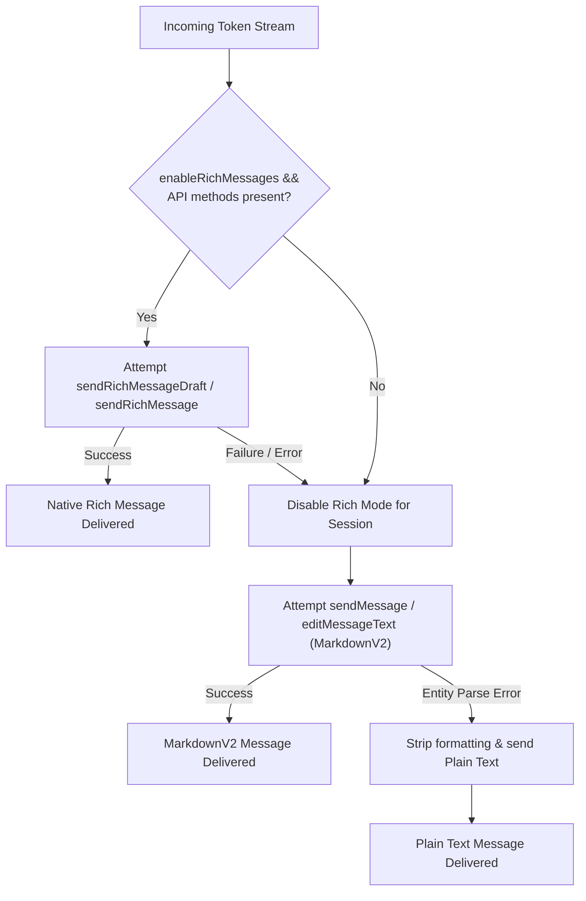

# System Architecture

## High-Level Overview

`tg-bot-agent-streamer` is a real-time bridge connecting Telegram users to the `pi` AI coding agent (`@earendil-works/pi-coding-agent`). The bridge runs `pi` in bidirectional RPC mode (`pi --mode rpc`) as a long-running subprocess communicating over `stdin` and `stdout` using strict newline-delimited JSON (JSONL).

The system handles token-level streaming, interactive tool call tracking, multimodal image attachments, and agent control commands (such as steering, aborting, and switching sessions or models) while respecting Telegram's strict API rate limits and message parsing constraints.



---

## Subsystems & Layers

### 1. Presentation & Telegram Subsystem (`src/telegram/`, `src/bot.ts`)
- **Location**: [`src/bot.ts`](../src/bot.ts), [`src/telegram/throttler.ts`](../src/telegram/throttler.ts), [`src/telegram/rich-parser.ts`](../src/telegram/rich-parser.ts), [`src/telegram/rich-table.ts`](../src/telegram/rich-table.ts), [`src/telegram/rich-text.ts`](../src/telegram/rich-text.ts), [`src/telegram/rich-types.ts`](../src/telegram/rich-types.ts), [`src/telegram/markdown.ts`](../src/telegram/markdown.ts), [`src/telegram/media.ts`](../src/telegram/media.ts).
- **Responsibilities**:
  - Authenticate incoming updates against `ALLOWED_USER_IDS`.
  - Handle bot commands (`/start`, `/status`, `/stop`, `/abort`, `/new`) and conversational messages.
  - Download photo attachments and convert them to base64 images for multimodal prompts.
  - Buffer streaming text deltas and tool call indicators, throttling Telegram edits to at least 1,000ms.
  - Parse markdown documents into structured native `InputRichMessage` objects (Bot API 10.1+), including tables, headers, lists, code blocks, blockquotes, expandable details, and inline formatting.
  - Stream live drafts using `sendRichMessageDraft` with active `InputRichBlockThinking` status blocks.
  - Finalize completed turns with `sendRichMessage` containing fully formatted native blocks.
  - Two-tier fallback: gracefully degrade to classic `sendMessage` / `editMessageText` with balanced MarkdownV2, and further to stripped plain text if entity parsing errors occur.
  - Automatically split oversized classic messages exceeding 4,000 characters into consecutive messages.

### 2. Orchestration & Configuration Layer (`src/index.ts`, `src/config.ts`)
- **Location**: [`src/index.ts`](../src/index.ts), [`src/config.ts`](../src/config.ts).
- **Responsibilities**:
  - Load environment variables (`.env`) with Zod schema validation.
  - Instantiate and wire `PiClient` and `grammY` bot instance.
  - Implement graceful shutdown on `SIGINT` and `SIGTERM`.
  - Handle unexpected process crashes or unhandled rejections.

### 3. Agent RPC Subsystem (`src/pi/`)
- **Location**: [`src/pi/client.ts`](../src/pi/client.ts), [`src/pi/framing.ts`](../src/pi/framing.ts), [`src/pi/types.ts`](../src/pi/types.ts).
- **Responsibilities**:
  - Spawn and monitor the `pi --mode rpc` child process.
  - Frame outgoing JSON commands strictly with LF (`\n`).
  - Buffer incoming stdout bytes and split exclusively on `\n` to prevent JSON corruption from Unicode line separators (`U+2028`, `U+2029`).
  - Emit typed EventEmitter events (`turn_start`, `message_update`, `toolcall_start`, `toolcall_end`, `turn_end`, `agent_settled`).
  - Manage in-flight requests, abort signals, and steering behavior.

---

## Request Lifecycle & Streaming Data Flow



---

## Native Rich Message Pipeline (Telegram Bot API 10.1+)

The bot supports native Telegram Rich Messages, providing structured block elements and interactive table rendering without escaping artifacts.

### 1. Modular AST Parsing Hierarchy

```
Markdown Document
      │
      ▼
src/telegram/rich-parser.ts (Document Orchestrator: InputRichMessage)
      │
      ├── Sections / Headings (`#`) ──────────────► InputRichBlockSectionHeading
      ├── Preformatted Code (```` ``` ````) ─────────────► InputRichBlockPreformatted
      ├── Blockquotes (`>`) ──────────────────────► InputRichBlockBlockQuotation
      ├── Expandable Details (`<details>`) ───────► InputRichBlockDetails
      ├── AI Thinking (`<thinking>`) ─────────────► InputRichBlockThinking
      ├── Unordered/Ordered/Task Lists ───────────► InputRichBlockList
      ├── Tables (`| col1 | col2 |`)
      │         │
      │         ▼
      │   src/telegram/rich-table.ts (GFM Table Parser: InputRichBlockTable)
      │         │
      │         ▼
      └── Paragraphs / Text Segments
                │
                ▼
          src/telegram/rich-text.ts (Inline Tokenizer: RichText)
          (Bold, Italic, Underline, Strikethrough, Code, Links, Math)
```

- **`rich-types.ts`**: Re-exports and strengthens Telegram Bot API 10.1+ interfaces (`InputRichMessage`, `InputRichBlock`, `RichText`, `RichBlockTableCell`, etc.) from `@grammyjs/types`.
- **`rich-text.ts`**: Safely tokenizes inline markdown into nested `RichText` objects while masking escaped punctuation and tolerating incomplete formatting tags during streaming.
- **`rich-table.ts`**: Parses GitHub Flavored Markdown (GFM) tables into native `InputRichBlockTable` objects (`cells: RichBlockTableCell[][]`), detecting column alignments (`:---`, `:---:`, `---:`), setting `is_header: true` on header cells, and applying default table styles (`is_bordered`, `is_striped`, `is_compact`).
- **`rich-parser.ts`**: Converts full markdown documents into top-level `InputRichMessage` objects with appropriate structured blocks.

### 2. Live Draft Streaming & Thinking Blocks (`sendRichMessageDraft`)

During token streaming:
1. `StreamThrottler` buffers incoming text deltas from `PiClient`.
2. Every $\ge 1000\text{ms}$, the throttler parses the buffer into an `InputRichMessage`.
3. If a tool is currently running (indicated by `toolcall_start`), an `InputRichBlockThinking` block (`⚙️ Running: <toolName>...`) is appended to the draft.
4. The draft is dispatched to Telegram via `sendRichMessageDraft(chatId, draftId, richMessage)`.
5. When `agent_settled` triggers, `finalize()` dispatches the completed content via `sendRichMessage(chatId, richMessage)` with thinking blocks cleanly removed.

### 3. Resilient Two-Tier Fallback Architecture

To ensure uninterrupted service across diverse chat types (private, groups, channels) and older Telegram clients:



1. **Tier 1 (Rich Messages)**: When `enableRichMessages` is configured and the Telegram API client implements `sendRichMessageDraft` / `sendRichMessage`, the throttler attempts native structured streaming.
2. **Tier 2 (Classic Fallback)**: If a rich draft or message call throws an error (e.g. method not supported in group chat or payload rejected), the throttler silently catches the error, marks rich messages disabled for that active session, and smoothly switches to classic `sendMessage` / `editMessageText` with balanced MarkdownV2.
3. **Emergency Plain Text Fallback**: If Telegram rejects MarkdownV2 entities, the text is automatically stripped of formatting and re-sent as plain unformatted text.
