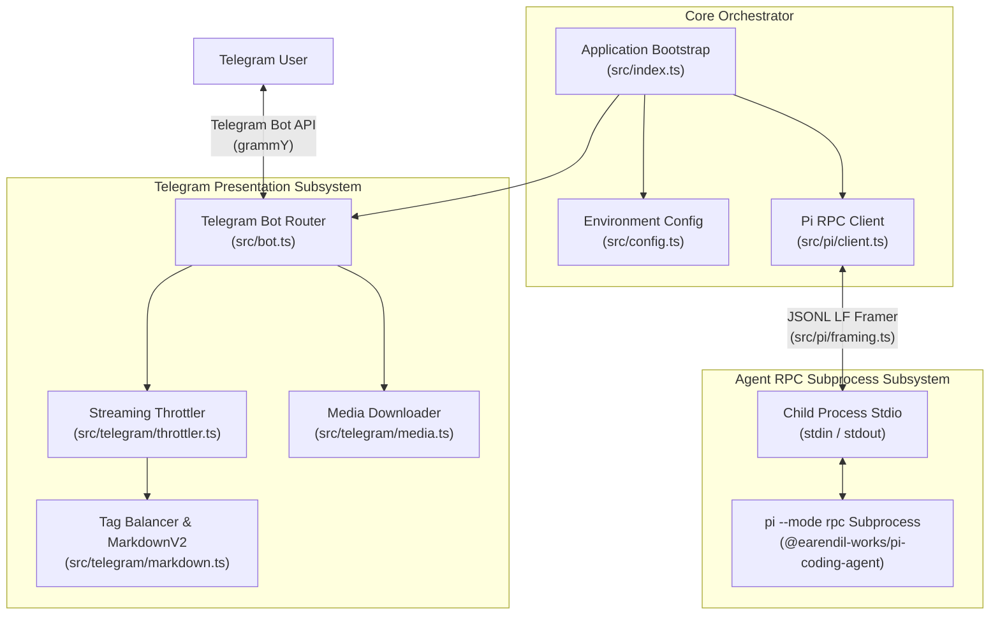
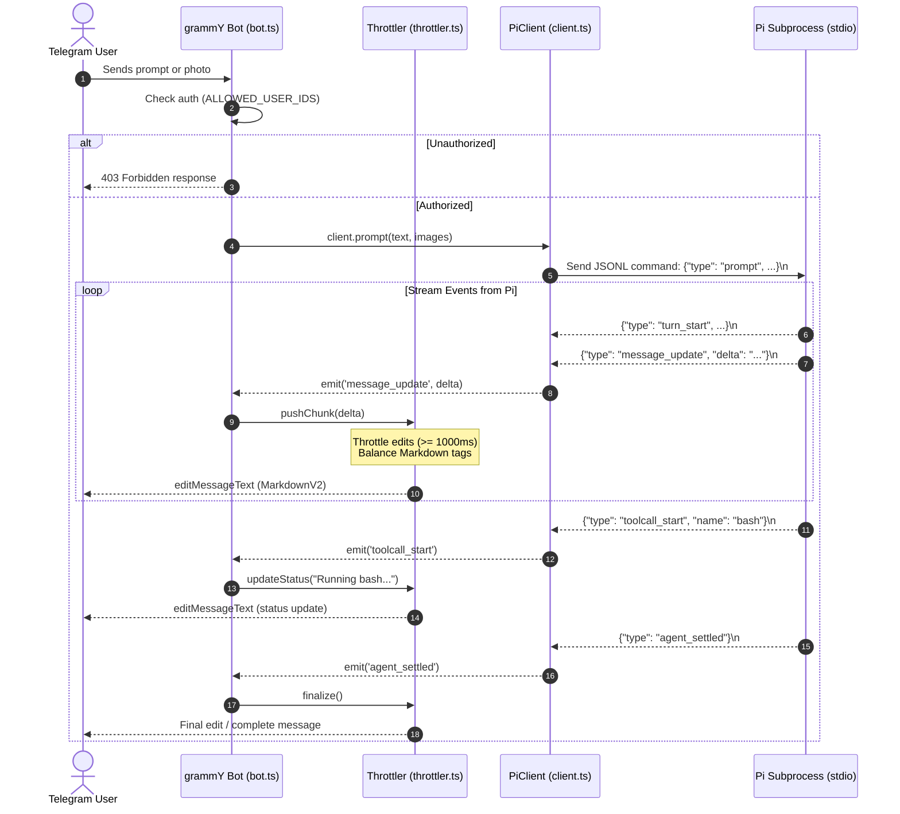

# System Architecture

## High-Level Overview

`tg-bot-agent-streamer` is a real-time bridge connecting Telegram users to the `pi` AI coding agent (`@earendil-works/pi-coding-agent`). The bridge runs `pi` in bidirectional RPC mode (`pi --mode rpc`) as a long-running subprocess communicating over `stdin` and `stdout` using strict newline-delimited JSON (JSONL).

The system handles token-level streaming, interactive tool call tracking, multimodal image attachments, and agent control commands (such as steering, aborting, and switching sessions or models) while respecting Telegram's strict API rate limits and message parsing constraints.

---

## Subsystems & Layers

### 1. Presentation & Telegram Subsystem (`src/telegram/`, `src/bot.ts`)
- **Location**: [`src/bot.ts`](../src/bot.ts), [`src/telegram/throttler.ts`](../src/telegram/throttler.ts), [`src/telegram/markdown.ts`](../src/telegram/markdown.ts), [`src/telegram/media.ts`](../src/telegram/media.ts).
- **Responsibilities**:
  - Authenticate incoming updates against `ALLOWED_USER_IDS`.
  - Handle bot commands (`/start`, `/status`, `/abort`, `/model`, `/session`) and conversational messages.
  - Download photo attachments and convert them to base64 images for multimodal prompts.
  - Buffer streaming text deltas and tool call indicators, throttling Telegram edits to at least 1,000ms.
  - Balance unclosed markdown tags (code blocks, bold, italics, spoilers) and render Telegram-safe MarkdownV2.
  - Automatically split long agent responses exceeding 4,000 characters into consecutive messages.
  - Fall back to plain unformatted text if Telegram rejects partial MarkdownV2 entities.

### 2. Orchestration & Configuration Layer (`src/index.ts`, `src/config.ts`)
- **Location**: [`src/index.ts`](../src/index.ts), [`src/config.ts`](../src/config.ts).
- **Responsibilities**:
  - Load environment variables (`.env`) with Zod schema validation.
  - Instantiate and wire `PiClient` and `grammY` bot instance.
  - Implement graceful shutdown on `SIGINT` and `SIGTERM`.
  - Handle unexpected process crashes or unhandled rejections.

### 3. Agent RPC Subsystem (`src/pi/`)
- **Location**: [`src/pi/client.ts`](../src/pi/client.ts), [`src/pi/framing.ts`](../src/pi/framing.ts), [`src/pi/types.ts`](../src/pi/types.ts).
- **Responsibilities**:
  - Spawn and monitor the `pi --mode rpc` child process.
  - Frame outgoing JSON commands strictly with LF (`\n`).
  - Buffer incoming stdout bytes and split exclusively on `\n` to prevent JSON corruption from Unicode line separators (`U+2028`, `U+2029`).
  - Emit typed EventEmitter events (`turn_start`, `message_update`, `toolcall_start`, `toolcall_end`, `turn_end`, `agent_settled`).
  - Manage in-flight requests, abort signals, and steering behavior.

---

## Request Lifecycle & Streaming Data Flow

