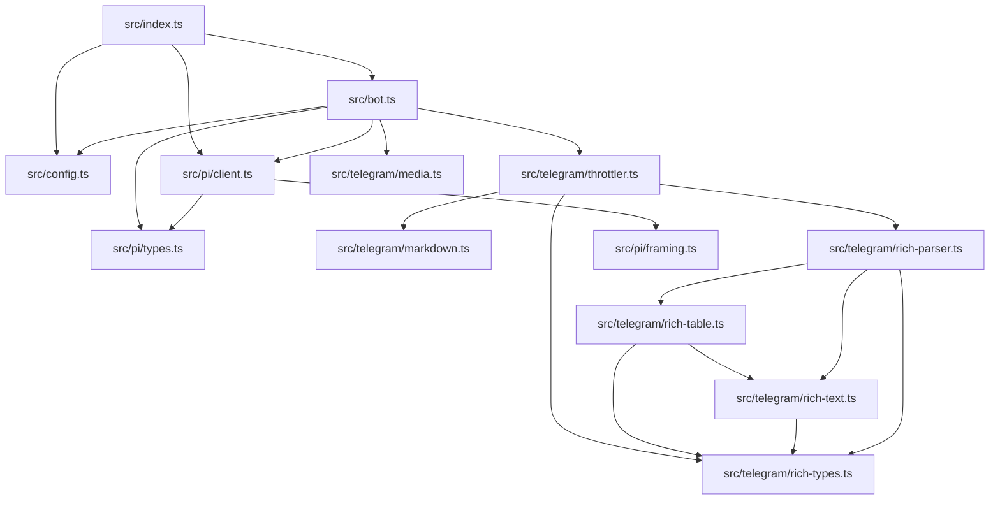

# Dependencies & Ecosystem

This document details the internal module relationships, core shared hubs, third-party libraries, and external process dependencies for `tg-bot-agent-streamer`.

---

## 1. Internal Dependency Graph

The internal topological graph was mapped by parsing module imports across the codebase:

- **Total Internal Edges**: 32 relationships.
- **Primary Application Entrypoint**: [`src/index.ts`](../src/index.ts) (orchestrates bot bootstrap and subprocess lifecycle).
- **Secondary / Subsystem Entrypoint**: [`src/bot.ts`](../src/bot.ts) (handles Telegram webhook/polling updates).
- **Core Hub Modules** (most frequently imported internally):
  1. [`src/config.ts`](../src/config.ts) (imported by 6 files): Core configuration loader and schema validator.
  2. [`src/pi/client.ts`](../src/pi/client.ts) (imported by 4 files): Manages subprocess communications and events.
  3. [`src/bot.ts`](../src/bot.ts) (imported by 3 files): Central Telegram bot router and handler dispatcher.
  4. [`src/pi/types.ts`](../src/pi/types.ts) (imported by 2 files): Protocol data transfer objects and interfaces.
  5. [`src/telegram/throttler.ts`](../src/telegram/throttler.ts) (imported by 2 files): Streaming buffer and rate limiter.
  6. [`src/pi/framing.ts`](../src/pi/framing.ts) (imported by 2 files): LF JSONL framing and serialization.
  7. [`src/telegram/markdown.ts`](../src/telegram/markdown.ts): Markdown balancing and MarkdownV2 formatting.
  8. [`src/telegram/media.ts`](../src/telegram/media.ts): Telegram photo downloader and base64 encoder.

---

## 2. Third-Party Libraries

| Package | Version | Purpose | Key Usage Files |
| :--- | :--- | :--- | :--- |
| `grammy` | `^1.46.0` | Telegram Bot Framework (updates, middleware, keyboards, API calls) | [`src/bot.ts`](../src/bot.ts), [`src/telegram/throttler.ts`](../src/telegram/throttler.ts), [`src/telegram/media.ts`](../src/telegram/media.ts) |
| `@grammyjs/auto-retry` | `^2.0.2` | Automatically handles Telegram 429 Too Many Requests errors with backoff | [`src/bot.ts`](../src/bot.ts) |
| `@grammyjs/stream` | `^1.1.0` | Streaming utilities for Telegram bot interactions | [`src/telegram/throttler.ts`](../src/telegram/throttler.ts) |
| `telegramify-markdown` | `^1.3.3` | Converts standard markdown strings to Telegram-safe MarkdownV2 entities | [`src/telegram/markdown.ts`](../src/telegram/markdown.ts) |
| `zod` | `^4.6.7` | Runtime type validation for environment variables and protocol schemas | [`src/config.ts`](../src/config.ts), [`src/pi/types.ts`](../src/pi/types.ts) |
| `dotenv` | `^18.0.9` | Loads environment variables from `.env` files | [`src/config.ts`](../src/config.ts) |
| `vitest` | `^5.1.0` | Test framework for unit, integration, and streaming timing tests | All files in [`tests/`](../tests/) |
| `tsx` | `^4.23.15` | Fast TypeScript execution and watch mode for local development | `package.json` (`pnpm dev`) |
| `typescript` | `^7.0.2` | Static type checker and production compiler | `package.json` (`pnpm build`, `pnpm typecheck`) |

---

## 3. External Services & Process Environment

1. **Telegram Bot API**:
   - Outbound HTTPS network requests to `https://api.telegram.org/bot<TOKEN>/...`.
   - Polling / long-polling mechanism implemented via `grammY`.
2. **`pi` CLI Coding Agent Subprocess**:
   - Package: `@earendil-works/pi-coding-agent`.
   - Command: `pi --mode rpc` (spawned via `node:child_process`).
   - Communication: Bidirectional stdio with strict LF-delimited JSONL lines.
   - Working Directory: Configurable via `PI_WORKDIR` (defaults to current repository root).
