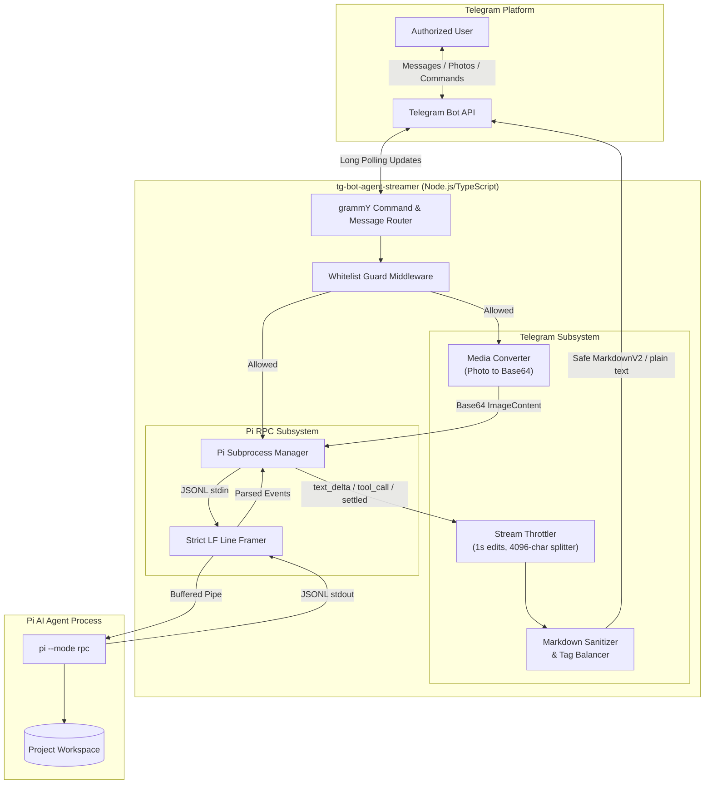
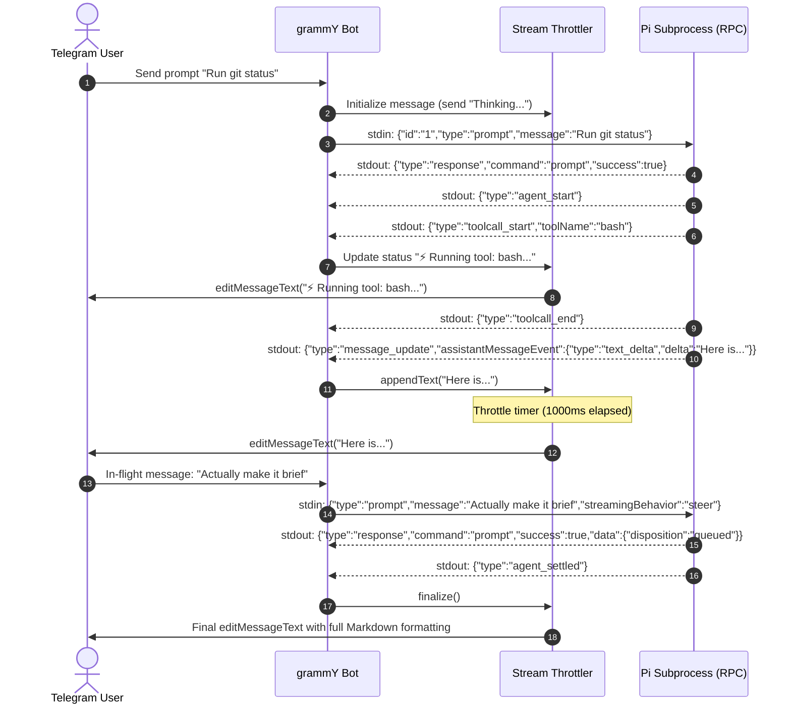

# System Architecture & Design

This document details the architectural components, process boundaries, data flows, and state machines of the `tg-bot-agent-streamer` bridge.

---

## 1. High-Level Architecture

The bridge acts as a stateful adapter between the Telegram Bot API and a long-lived `pi` child process running in RPC mode:



---

## 2. Core Components

### 2.1 Whitelist Middleware (`src/bot.ts`)
- Intercepts all incoming updates from Telegram before any handler runs.
- Checks `ctx.from?.id` against the parsed numeric set of `ALLOWED_TELEGRAM_USER_IDS`.
- Drops or replies with an unauthorized notification to unknown users, ensuring that only trusted users can trigger tool executions on the host.

### 2.2 Pi RPC Client (`src/pi/client.ts`)
- Spawns and supervises `pi --mode rpc` with designated flags (`--session-dir`, `--model`, etc.).
- Keeps track of execution state:
  - `isIdle`: Ready for new prompt.
  - `isStreaming`: Agent is actively reasoning, calling tools, or generating output.
  - `currentTool`: Name and arguments of any active tool execution.
- Maps command IDs to promises for request/response synchronization.
- Emits high-level typed events to consumers.

### 2.3 Strict LF Line Framer (`src/pi/framing.ts`)
- Manages raw byte streams over stdin/stdout.
- Emits records strictly on `\n` line delimiters.
- Strips optional `\r`.
- Ensures zero corruption from embedded Unicode line separators (`U+2028`, `U+2029`).

### 2.4 Stream Throttler (`src/telegram/throttler.ts`)
- Bridges continuous token events from LLM streams to Telegram's discrete edit rate limits.
- Holds an internal buffer of tokens.
- Flushes updates to Telegram via `editMessageText` at most once every $1000\text{ms}$.
- Periodically triggers `sendChatAction(chatId, "typing")` every 4 seconds.
- Automatically handles the 4096-character limit by finalizing the current message and sending a new message chunk.

### 2.5 Markdown Engine (`src/telegram/markdown.ts`)
- Handles unclosed tags (` ``` `, `*`, `_`, `||`) in streaming buffers using dynamic tag balancing.
- Converts Markdown to Telegram-safe MarkdownV2 using `telegramify-markdown`.
- Provides an automated fallback to plain text if Telegram rejects the formatted payload.

---

## 3. Communication & Turn Sequence


